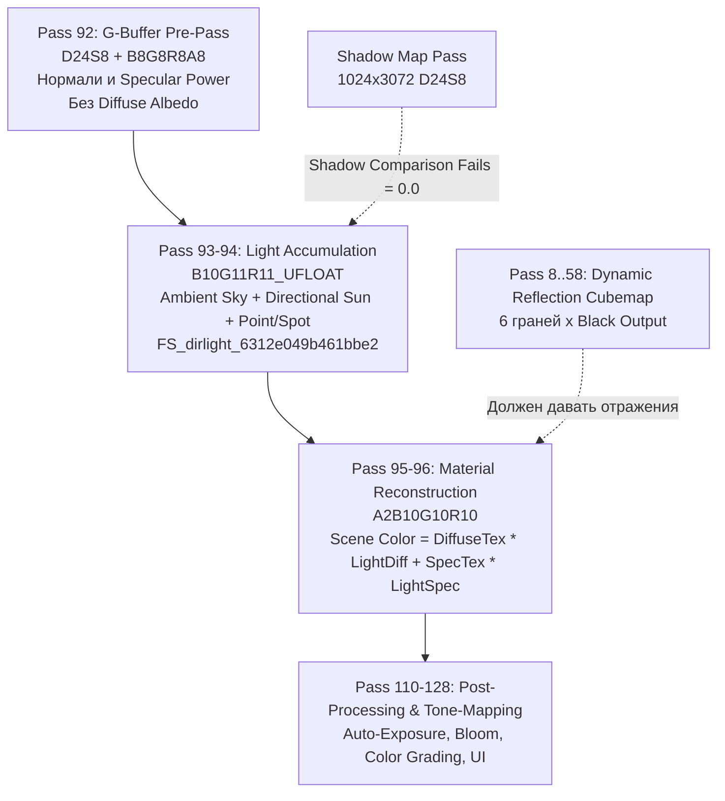
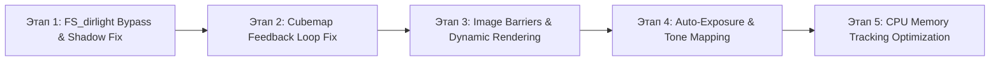

# Phase 4 Graphics & Lighting Engineering Plan
## Need for Speed: Hot Pursuit Remastered (`010029B0118E8000`) on Adreno 650 / Turnip

---

## 1. Контекст и архитектурный диагноз

Движок Chameleon (Criterion Games) использует архитектуру **Light Pre-Pass (Deferred Lighting)**, а не стандартный Deferred Shading:

### Текущие критические проблемы (Hard Blockers):
1. **Light Buffer Collapse (Солнце = 0.0):** В шейдере солнца `FS_dirlight_6312e049b461bbe2` проверка каскадных теней (`OpImageSampleDrefImplicitLod`) всегда возвращает `0.0`. Солнечный свет полностью обнуляется. В буфере света остается только скайбокс ($RGB \approx [0.03, 0.04, 0.05]$).
2. **Мертвые кубмапы отражений (Passes 8..58):** Все 6 проходов рендеринга кубмапы падают в `attachment feedback loop split`, дропают глубину и выдают `mean 0.00000` (чистый черный цвет). Нет отражений ни на машинах, ни на мокром асфальте.
3. **Ошибки тональной компрессии (Tone-Mapping / Auto-Exposure):** Пайплайн автоэкспозиции (проходы вычисления средней яркости) адаптируется под темную сцену, искажая экспозиционную кривую.
4. **Огромный оверхед CPU на Write-Protection:** 175,274 перехваченных `SIGSEGV` за сессию из-за постраничной защиты памяти для трекинга текстур.

---

## 2. Поэтапный план реализации

---

### Этап 1: Прямой солнечный свет и каскадные тени (`FS_dirlight`)
**Цель:** Восстановить прямое освещение сцены солнцем и проявить текстуры мира.

- [ ] **Шаг 1.1: Диагностический байпас теней (Sanity Check)**
  - В шейдере `FS_dirlight_6312e049b461bbe2` (или в трансляторе `gfx_vk_pipe.c`) переопределить результат shadow sampling на константу `1.0` (полное освещение).
  - Собрать APK, запустить гонку, сделать скриншот.
  - *Критерий успеха:* Трасса, горы и окружение мгновенно становятся ярко освещенными, текстуры асфальта и скал четко видны.
- [ ] **Шаг 1.2: Анализ SPIR-V и Shadow Comparison Op**
  - Декомпилировать `FS_dirlight_6312e049b461bbe2.spv`.
  - Проверить:
    - Функцию сравнения глубины (`VkCompareOp`: `LESS_OR_EQUAL` vs `GREATER_OR_EQUAL` / Reversed-Z).
    - Координаты выборки каскадов (диапазон $Z \in [0, 1]$ против $[-1, 1]$).
    - Формат сэмплера тени (`D24_UNORM_S8_UINT` vs `D32_SFLOAT`).
- [ ] **Шаг 1.3: Корректный фикс проекции теней**
  - Исправить несоответствие глубины в трансляторе SPIR-V или сэмплере `gfx_vk_tex.c`.
  - Убрать байпас `1.0`, включить реальные мягкие тени от солнца.

---

### Этап 2: Восстановление динамических кубмап отражений (Passes 8..58)
**Цель:** Устранить черные отражения на машинах и мокрой дороге.

- [ ] **Шаг 2.1: Анализ Attachment Feedback Loop**
  - Изучить лог проходов 8, 18, 28, 38, 48, 58 в `gfx_vk_exec.c`.
  - Определить, почему Adreno/Turnip видит feedback loop: движок читает предыдущий фрейм кубмапы во время рендеринга новой грани, либо сэмплер привязан к тому же `VkImage`.
- [ ] **Шаг 2.2: Внедрение Copy-on-Write / Ping-Pong Buffer**
  - Вместо грубого `g_split_no_depth` сделать копирование грани (`vkCmdCopyImage`) перед началом рендеринга, разрывая петлю обратной связи.
  - Сохранить depth attachment интактным во время проходов кубмапы.
- [ ] **Шаг 2.3: Верификация дампов граней**
  - Снять дампы проходов 8–58: средняя яркость (`mean`) должна быть $> 0.05$.
  - Проверить зеркальные блики на кузове автомобиля в гонке.

---

### Этап 3: Синхронизация и барьеры Dynamic Rendering (`DM_VK_RP=0`)
**Цель:** Исключить артефакты UBWC и гонки данных между проходами.

- [ ] **Шаг 3.1: Аудит переходов лейаутов изображений**
  - Проверить переходы для:
    - Pass 92 Color 0 (`B8G8R8A8_UNORM`): `COLOR_ATTACHMENT_OPTIMAL` $\rightarrow$ `SHADER_READ_ONLY_OPTIMAL` (для Pass 93).
    - Pass 92 Depth (`D24S8`): `DEPTH_STENCIL_ATTACHMENT_OPTIMAL` $\rightarrow$ `DEPTH_STENCIL_READ_ONLY_OPTIMAL` (для Pass 93).
    - Pass 93 Color 0 (`B10G11R11_UFLOAT`): `COLOR_ATTACHMENT_OPTIMAL` $\rightarrow$ `SHADER_READ_ONLY_OPTIMAL` (для Pass 95).
- [ ] **Шаг 3.2: Корректировка Pipeline Barriers в `gfx_vk_exec.c`**
  - Убедиться, что `srcStageMask` и `dstStageMask` содержат `VK_PIPELINE_STAGE_COLOR_ATTACHMENT_OUTPUT_BIT` $\rightarrow$ `VK_PIPELINE_STAGE_FRAGMENT_SHADER_BIT`.

---

### Этап 4: Пайплайн автоэкспозиции и пост-обработки (Passes 110..128)
**Цель:** Предотвратить пересвет или провал в черноту после включения солнца.

- [ ] **Шаг 4.1: Мониторинг буфера адаптации яркости**
  - После оживления солнца проверить, как шейдер экспозиции (downsample pyramid) реагирует на яркие участки.
  - Исключить появление `NaN` или `INF` в буфере `VK_FORMAT_B10G11R11_UFLOAT_PACK32`.
- [ ] **Шаг 4.2: Калибровка тонального отображения (Tone-Mapper)**
  - Проверить соответствие кривой тонального отображения оригинальной Switch-версии (контрастность, Bloom threshold).

---

### Этап 5: Оптимизация трекинга памяти (CPU Overhead)
**Цель:** Устранить фризы и микростаттеры от обработки 175k сигналов `SIGSEGV`.

- [ ] **Шаг 5.1: Профилирование источников Faults**
  - Логировать диапазоны адресов, вызывающих write faults в `nxnative/dm/host/memflow.c`.
  - Выявить буферы, которые часто перезаписываются CPU (динамические константные буферы против статичных текстур).
- [ ] **Шаг 5.2: Пакетный трекинг / Staging ring**
  - Для часто обновляемых буферов снять защиту `PROT_NONE` / `PROT_READ` и перевести на явную синхронизацию перед submit.

---

## 3. Очередность выполнения

| Шаг | Задача | Риск | Трудоемкость | Зависимости |
| :--- | :--- | :---: | :---: | :--- |
| **1.1** | Диагностический байпас теней (`FS_dirlight = 1.0`) | Низкий | 15 мин | Нет |
| **1.2** | Дизассемблирование и реверс SPIR-V `FS_dirlight` | Средний | 30 мин | Шаг 1.1 |
| **1.3** | Починка каскадных теней | Высокий | 1-2 ч | Шаг 1.2 |
| **2.1** | Фикс кубмап отражений (Copy-on-Write) | Средний | 1 ч | Шаг 1.1 |
| **3.1** | Аудит барьеров Dynamic Rendering | Средний | 45 мин | Шаг 1.3, 2.1 |
| **4.1** | Калибровка экспозиции и пост-эффектов | Низкий | 30 мин | Шаг 1.3 |
| **5.1** | Оптимизация `SIGSEGV` fault overhead | Высокий | 2 ч | Завершение рендера |
